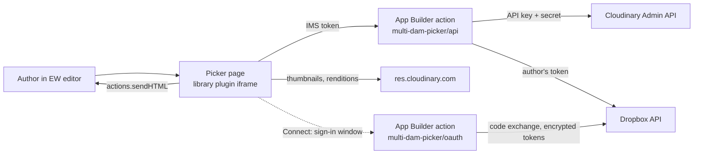

# Multi-DAM Asset Picker (library plugin)

An Experience Workspace (EW) library plugin that lets authors **browse, search, filter and insert assets from a third-party DAM**
while editing a page. Authors see it as **Cloudinary Asset Picker** or **Dropbox Asset Picker**: the heading reads "<DAM label> Asset
Picker", taken from the selected DAM. The extension folder and backend keep the name `multi-dam-picker`, because the picker shell,
provider interface and backend are DAM-agnostic: a DAM is one module and one registry line. Cloudinary (one shared credential, ticket
#23, spec [SPEC.md](SPEC.md)) and Dropbox (each author connects their own account, ticket #25, spec
[providers/dropbox/SPEC.md](providers/dropbox/SPEC.md)) are built; Bynder and Frontify follow.

- **Browse and search** (typing searches after a short pause, Enter searches at once), filter by type (images, videos, documents,
  audio), sort by newest, oldest, name or relevance, "Load more".
- **Insert** an image with a chosen rendition (default `web`: at most 1200 px wide, automatic format and quality, never upscaled) and
  alt text prefilled from the asset's metadata (editable, or mark the image decorative). Videos, audio, PDFs and other files are
  inserted as a link with the asset name.
- **Cloudinary: no sign-in for authors.** The Cloudinary API key and secret live only in the extension's Adobe App Builder backend
  (`worker/`). The browser calls only that backend, with the author's Adobe IMS token from EW.
- **Dropbox: each author connects their own account** once ("Connect to Dropbox" opens a sign-in window). The backend stores the
  tokens encrypted and refreshes them; the browser never sees a Dropbox token or secret and never calls Dropbox. An author sees only
  their own files. Inserting an image creates (or reuses) a **public Dropbox link** to it (see [Dropbox provider](#dropbox-provider)).



| Item | Value |
| --- | --- |
| DA test site | `https://da.live/#/jazhou-adobe/ew-extensions-demo` |
| App Builder | org `adobe-demo-apac-195`, project `ew extensions` |
| Stage backend | `https://281295-ewextensions-stage.adobeioruntime.net/api/v1/web/multi-dam-picker/api` |
| Stage OAuth action | `https://281295-ewextensions-stage.adobeioruntime.net/api/v1/web/multi-dam-picker/oauth` (the sign-in pop-up only; no IMS token) |
| Production backend | `https://281295-ewextensions.adobeioruntime.net/api/v1/web/multi-dam-picker/api` (not deployed yet) |
| Cloudinary test environment | cloud name `yifoe45l`, root folder `samples/` |

---

## 1. Installing

### Prerequisites

- Node 22 and `npm ci` in the repo root.
- Adobe `aio` CLI logged in, with org `adobe-demo-apac-195` and project `ew extensions` selected (`env -u CI aio where`).
  Run every `aio` command as `env -u CI aio ...` if your shell sets `CI=true`.
- A Cloudinary account (the Free plan is enough) and config-write access to the DA test site.

### Getting the keys and accounts

You need four things. The Cloudinary key and secret and the `AIO_*` lines are secrets: keep them only in the untracked `.env`.

| What | Used for | Secret? |
| --- | --- | --- |
| Cloudinary cloud name | `CLOUDINARY_CLOUD_NAME` in `worker/.env` | no |
| Cloudinary API key and API secret | `CLOUDINARY_API_KEY`, `CLOUDINARY_API_SECRET` in `worker/.env` | **yes** |
| Adobe App Builder project and `aio` login | deploying the backend; `aio app use` writes the `AIO_*` lines to `.env` | **yes** (`AIO_*` lines) |
| DA site config access | adding the `library` row | n/a |

**1. Cloudinary account, cloud name, API key and secret**

1. Sign up at <https://cloudinary.com/users/register_free> (email, Google or GitHub; no credit card). If asked, choose
   **Programmable Media**.
2. Log in to <https://console.cloudinary.com>, click the **gear icon (Settings)** at the bottom left, then **API Keys**.
   Older consoles show the same values on the Dashboard under "Product Environment Credentials".
3. Copy the **Cloud name** (top of the page) and the **API Key**. Click the eye or copy icon to reveal the **API Secret**.
4. Optional but recommended: click **Generate New API Key** to create a key used only by this picker, so you can revoke it
   without affecting anything else.
5. Put the values **only** in `apps/multi-dam-picker/worker/.env` (gitignored). Never paste the secret into chat, issues, commits or
   screenshots. If it leaks, open the key's row menu, choose **Regenerate secret**, update `.env` and redeploy.

**2. Adobe App Builder project and `aio` login**

1. Open <https://developer.adobe.com/console> and switch to org `adobe-demo-apac-195` (any org with App Builder works).
2. Use the existing project `ew extensions`, or create one with **Create project from template > App Builder**. The template creates
   the **Stage** and **Production** workspaces.
3. Install the CLI and log in from your own terminal. Interactive login does not work in a shell with `CI=true`, hence `env -u CI`:

   ```sh
   npm install -g @adobe/aio-cli
   env -u CI aio login
   env -u CI aio console org select         # adobe-demo-apac-195
   env -u CI aio console project select     # ew extensions
   env -u CI aio console workspace select   # Stage
   env -u CI aio where                      # shows the org, project and workspace
   ```

4. `env -u CI aio app use` (run in `worker/`, see [Deploy the backend](#deploy-the-backend)) writes the workspace credentials into
   `.env` (`AIO_*` lines) and `.aio`. Both are gitignored; never commit them.

**3. DA site config access**

Open `https://da.live/config#/jazhou-adobe/ew-extensions-demo/`. If you can edit the `library` tab, you have access; otherwise ask the
site's admin to grant your Adobe ID config-write permission.

**4. IMS token (only for the optional live tests)**

Open the demo site in the EW editor, open DevTools > Network, open the picker, click a request to the backend and copy the value after
`Bearer ` in its `Authorization` header. It expires after a few hours. Use it only in `IMS_TOKEN=` in your terminal; never commit or
paste it.

### Cloudinary-side setup

1. **Cloud name, key and secret:** see [Getting the keys and accounts](#getting-the-keys-and-accounts). The cloud name is public; the
   key and secret go **only** into `worker/.env`.
2. **Test assets:** upload a few images (and a video and a PDF if you like) into the root folder, e.g. `samples/`.
3. **Alt text:** add it in each asset's contextual metadata field `alt` (or the field you configure). Without it the picker falls back
   to the caption, then the file name, and tells the author which one it used.
4. **Folder mode:** accounts created after 2024-06-04 use `dynamic`. To check, call
   `GET https://api.cloudinary.com/v1_1/<cloud>/config?settings=true` with Basic auth.
5. **Strict transformations** (Console > Settings > Security): if on, unsigned transformed URLs are rejected and you must set
   `CLOUDINARY_SIGN_URLS=true`. Signing is proven by known-answer tests but **not yet against a strict-enabled environment**, so keep
   it `false` until that check (SPEC M6) passes. Assets whose public ID needs percent-encoding (spaces, non-ASCII) cannot be inserted
   while signing is on.
6. **Private CDN or CNAME:** list the host in `CLOUDINARY_DELIVERY_HOSTS`. **EU or AP data centre:** set `CLOUDINARY_API_HOST`.

### Dropbox-side setup

Only needed to offer Dropbox. Without `DROPBOX_CLIENT_ID` and `DROPBOX_CLIENT_SECRET` (or without the three OAuth host settings
below) Dropbox is simply not listed, and Cloudinary works exactly as before. Create **one Dropbox app per workspace** (Stage,
Production): a development-status app for Stage, a separate app for Production.

**1. Create the Dropbox app** (Dropbox account owner; a free account is enough)

1. Open <https://www.dropbox.com/developers/apps> and sign in. Click **Create app**.
2. Choose an API: **Scoped access**. Choose the type of access: **Full Dropbox** (an App Folder app sees only `/Apps/<name>`, which
   cannot hold existing brand assets).
3. Name it, e.g. **EW Multi-DAM Picker** (Dropbox forbids the word "Dropbox" in the name, or a name starting with "drop"; the name
   cannot be changed after production approval). Click **Create app**.
4. **Permissions** tab: tick exactly these five scopes, then click **Submit** (a new scope only applies to connections made after
   the change):

   | Scope | Used for |
   | --- | --- |
   | `account_info.read` | the "Connected as ..." name |
   | `files.metadata.read` | search, folder listing, file details |
   | `files.content.read` | thumbnails |
   | `sharing.read` | finding an existing shared link |
   | `sharing.write` | creating the public link of a file that has none |

5. **Settings** tab:
   - Copy the **App key** (`DROPBOX_CLIENT_ID`, not secret) and click **Show** next to **App secret** (`DROPBOX_CLIENT_SECRET`, a
     **secret**: only in the untracked `worker/.env`, never in chat, tickets or the browser).
   - **Redirect URIs:** add exactly `<OAUTH_PUBLIC_BASE_URL>/dropbox/callback`. The base URL exists only after the first deploy (see
     [Deploy the backend](#deploy-the-backend)): for Stage it is
     `https://281295-ewextensions-stage.adobeioruntime.net/api/v1/web/multi-dam-picker/oauth`, so the redirect URI is
     `https://281295-ewextensions-stage.adobeioruntime.net/api/v1/web/multi-dam-picker/oauth/dropbox/callback`. Click **Add**. The
     `ref=local` page also uses the Stage backend, so no `localhost` URI is needed.
   - **Allow public clients (Implicit Grant & PKCE):** **Disallow**. **Access token expiration:** keep **Short-lived** (tokens last
     four hours and the backend refreshes them).
6. A new app has **development status**: it can link your own account and users you add under **Settings > Development users**
   (the test accounts). Dropbox asks for production approval once the app has linked 50 users (apply within two weeks of the
   50th), with a privacy policy and branding review. Check Dropbox's developer terms before using it for published pages.

**2. Collect the settings**

| `.env` key | Value | Secret? |
| --- | --- | --- |
| `DROPBOX_CLIENT_ID` | the App key | no |
| `DROPBOX_CLIENT_SECRET` | the App secret | **yes** |
| `DROPBOX_ROOT_PATH` | optional folder the picker is confined to, e.g. `/Brand/Images` (empty = the whole Dropbox) | no |
| `OAUTH_PUBLIC_BASE_URL` | the `oauth` action URL from `env -u CI aio app get-url` (known after the first deploy) | no |
| `TOKEN_ENC_KEY` | random 32-byte base64 key that encrypts stored connections | **yes** |
| `OAUTH_STATE_KEY` | a second, different random 32-byte base64 key that seals sign-in tickets and states | **yes** |

Generate each key on your machine, once, and never reuse one for the other:

```sh
node -e "console.log(require('crypto').randomBytes(32).toString('base64'))"
```

### Deploy the backend

Run from `apps/multi-dam-picker/worker/`. Deploys are manual: Stage first, Production later.

```sh
cd apps/multi-dam-picker/worker
cp .env.example .env                      # cloud name and folder are prefilled
# edit .env: CLOUDINARY_API_KEY=...  CLOUDINARY_API_SECRET=...
env -u CI aio app use                     # pick Stage; appends AIO_* credentials to .env and writes .aio
git status --short                        # must list neither .env nor .aio
env -u CI aio app deploy                  # the pre-deploy guard runs first
env -u CI aio app get-url                 # expect the Stage backend URL above (and the oauth action URL)
```

**Adding Dropbox is a two-step deploy**, because the `oauth` action URL (hence the redirect URI) is only known after a deploy:

1. Fill `DROPBOX_CLIENT_ID`, `DROPBOX_CLIENT_SECRET`, `TOKEN_ENC_KEY` and `OAUTH_STATE_KEY` in `.env`; leave `OAUTH_PUBLIC_BASE_URL`
   empty; `env -u CI aio app deploy`. Dropbox stays hidden (a blank base URL means "OAuth host not configured").
2. `env -u CI aio app get-url` prints both action URLs. Put the `.../multi-dam-picker/oauth` one into `OAUTH_PUBLIC_BASE_URL` in `.env`,
   add `<that URL>/dropbox/callback` as the Dropbox app's redirect URI, then `env -u CI aio app deploy` again.

Both actions are deployed together: the `api` action (every call carries an IMS token) and the `oauth` action, which only answers the two
browser navigations of the sign-in window and is the only action without an IMS token (it checks sealed values instead and never
enables CORS).

The pre-deploy guard refuses a deploy when a `$NAME` input is missing from `.env`, a secret is empty, or `ALLOWED_LOCAL_ORIGINS` is
set on a non-Stage namespace. The OAuth and Dropbox settings are exempt from the missing/empty check (`optionalEnv` in
`worker/package.json`): blank means "not offered", so a Cloudinary-only deploy needs none of them.

**Redeploy after any change** to `worker/`, `providers/*/worker/`, `worker/app.config.yaml`, `.env` or `shared/worker-template/`.
The picker page alone does not need a redeploy.

**Production:** run `env -u CI aio app use` and pick Production, set `ALLOWED_LOCAL_ORIGINS=` (empty) in `.env`, then deploy. Pages on
`main--ew-extensions--jazhou-adobe.*` call Production; every other page calls Stage (see `config.js`).

**Rotating the secret:** create the new secret in the Cloudinary Console, update `CLOUDINARY_API_SECRET` in `.env`, then
`env -u CI aio app deploy --action api`. With signing on, every signature changes; URLs already inserted into published pages keep the
old signature (whether Cloudinary still accepts it is checked in SPEC M7).

### Install the picker page

Choose **one** way to serve the page. Option A is the one in use for the DA test site.

#### Option A (recommended): install into the DA test site repo

Copy the browser files into `ew-extensions-demo` (checked out next to this repo), then commit and push there:

```sh
npm run package:extension -- multi-dam-picker ../ew-extensions-demo
cd ../ew-extensions-demo
git add apps/multi-dam-picker && git commit -m "chore: update Cloudinary Asset Picker" && git push
```

The command replaces `ew-extensions-demo/apps/multi-dam-picker/` with the browser files only (no `worker/`, tests or docs) and records
the source commit in `.vendored.json`. It fails if a page module imports a file outside the extension folder. **Re-run it after every
picker change.** Pages served from `*--ew-extensions-demo--jazhou-adobe.*` always call the **Stage** backend, and the backend allows
those origins through its comma-list `SITE` input.

Then add this row to the `library` tab of `https://da.live/config#/jazhou-adobe/ew-extensions-demo/`. The path is relative, so it
resolves against the demo site itself:

| title | path | format | ref | icon | experience |
| --- | --- | --- | --- | --- | --- |
| Cloudinary Asset Picker | /apps/multi-dam-picker/multi-dam-picker.html | | | | fullsize-dialog |

#### Option B: serve from this repo

Requires the AEM Code Sync GitHub app on `jazhou-adobe/ew-extensions`; until it is installed,
`https://main--ew-extensions--jazhou-adobe.aem.live/...` returns 404.

##### `library` sheet row

In `https://da.live/config#/jazhou-adobe/ew-extensions-demo/`, `library` tab. Add these rows **in this order**: the editor shows the
first allowed row for a title, so the `local` and branch rows win over `main` only when the editor URL has the matching `?ref=`. The
code lives in this repo, not the demo site's repo, so the paths are absolute.

| title | path | format | ref | icon | experience |
| --- | --- | --- | --- | --- | --- |
| Cloudinary Asset Picker | http://localhost:3000/apps/multi-dam-picker/multi-dam-picker.html | | local | | fullsize-dialog |
| Cloudinary Asset Picker | https://BRANCH--ew-extensions--jazhou-adobe.aem.live/apps/multi-dam-picker/multi-dam-picker.html | | BRANCH | | fullsize-dialog |
| Cloudinary Asset Picker | https://main--ew-extensions--jazhou-adobe.aem.live/apps/multi-dam-picker/multi-dam-picker.html | | | | fullsize-dialog |

Replace `BRANCH` (twice) with a simple branch name (no `/`), and keep that row only while you test the branch. The `local` row
works without Code Sync: run `npm start` and open the editor with `?ref=local`. `experience` may also be blank (inline); the page
works in both. `fullsize-dialog` is known from the da-live source, not from the public docs.

### Site config read

None beyond the library row: the page reads no other site config.

---

## 2. Configuration

Every input of `worker/app.config.yaml`. `$NAME` values are read from `worker/.env` at deploy time; the others are literals in the app
config (edit them, then redeploy).

| Input | Kind | Meaning |
| --- | --- | --- |
| `CLOUDINARY_API_KEY` | **secret** (`.env`) | Cloudinary API key (Basic user). Required. |
| `CLOUDINARY_API_SECRET` | **secret** (`.env`) | Cloudinary API secret (Basic password and URL-signing secret). Required. |
| `CLOUDINARY_CLOUD_NAME` | `.env`, required | Product environment, e.g. `yifoe45l`. Public in every delivery URL. |
| `CLOUDINARY_ROOT_FOLDER` | `.env` | Folder the picker is confined to, with its subfolders (`samples/`). Empty = the whole environment. |
| `CLOUDINARY_FOLDER_MODE` | `.env` | `dynamic` (accounts created after 2024-06-04) or `fixed` (legacy). |
| `CLOUDINARY_SIGN_URLS` | `.env` | `true` signs every rendition and thumbnail URL on the server (needed with Strict transformations). |
| `ALLOWED_LOCAL_ORIGINS` | `.env` | Exact extra origins, comma list. Stage: `http://localhost:3000` for `ref=local`. Production: empty. |
| `DROPBOX_CLIENT_ID` | `.env`, optional | Dropbox app key. Blank = Dropbox is not offered. |
| `DROPBOX_CLIENT_SECRET` | **secret** (`.env`), optional | Dropbox app secret (token exchange and refresh). Blank = Dropbox is not offered. |
| `DROPBOX_ROOT_PATH` | `.env`, optional | Folder the browse and search are limited to (`/Brand/Images`). A UX guard, not a security boundary: the token can read everything the author can. |
| `DROPBOX_SCOPES` | literal | Space-separated scopes requested (default: the five in [Dropbox-side setup](#dropbox-side-setup); only those are accepted). |
| `DROPBOX_ALT_TEMPLATE_ID`, `DROPBOX_ALT_FIELD` | literal | Optional: a file-property template (`ptid:...`) and field name that hold alt text. Both or neither. |
| `DROPBOX_CACHE_SECONDS` | literal | Per-author result-cache lifetime in container memory (default `30`; `0` disables). |
| `OAUTH_PUBLIC_BASE_URL` | `.env`, optional | Public URL of the `oauth` action. Blank = no OAuth provider is offered. |
| `TOKEN_ENC_KEY` | **secret** (`.env`), optional | Encrypts stored Dropbox connections (AES-256-GCM). Blank = no OAuth provider is offered. |
| `TOKEN_ENC_KEY_PREVIOUS` | **secret** (`.env`), optional | The old `TOKEN_ENC_KEY` while rotating (see [OAuth plumbing](#oauth-plumbing)). |
| `OAUTH_STATE_KEY` | **secret** (`.env`), optional | Seals sign-in tickets and states; must differ from `TOKEN_ENC_KEY`. |
| `CONNECTION_TTL_DAYS` | literal | Retention of an idle connection record (default `180`, at most `365`). |
| `ORG`, `SITE` | literal | Code-site owner and code sites whose pages may call the backend. `SITE` is a comma list: `ew-extensions,ew-extensions-demo`. |
| `CLOUDINARY_API_HOST` | literal | One of `api.cloudinary.com` (default), `api-eu.cloudinary.com`, `api-ap.cloudinary.com`. |
| `CLOUDINARY_SIGNATURE_ALGORITHM` | literal | `sha1` (default) or `sha256`, matching the account's signature algorithm. |
| `CLOUDINARY_ALT_CONTEXT_FIELD` | literal | Contextual-metadata field holding alt text (default `alt`). |
| `CLOUDINARY_CAPTION_CONTEXT_FIELD` | literal | Contextual-metadata field used as the alt fallback (default `caption`). |
| `CLOUDINARY_ALT_METADATA_FIELD` | literal | Optional structured-metadata field for alt text (detail only; empty = unused). |
| `CLOUDINARY_RENDITIONS` | literal | Optional JSON list `[{ "id", "label", "transformation", "width" }]` replacing the default renditions (at most 8; `original` is reserved). |
| `CLOUDINARY_DELIVERY_HOSTS` | literal | Extra delivery hosts (private CDN or CNAME), comma list of bare host names. `res.cloudinary.com` is always allowed. |
| `CLOUDINARY_CACHE_SECONDS` | literal | Result-cache lifetime in seconds (default `30`; `0` disables). |

The other template inputs (`IMS_ORIGIN`, `ALLOWED_IMS_CLIENT_IDS`, `STATE_REGION`) are described in the
[backend template README](../../shared/worker-template/README.md).

**Default renditions:** `web` (1200 px), `large` (2000), `medium` (800), `small` (400). Each uses `c_limit` (scale down only) with
`f_auto` and `q_auto`, plus `original` for browser-displayable formats (jpg, jpeg, png, gif, webp, avif, svg).

**Adding a site that may call the backend:** add it to `SITE` in `worker/app.config.yaml`, redeploy, and (if that site should use a
specific backend) extend `workerFor` in `config.js`.

---

## 3. Testing

### Local development and automated tests

No login, no network, no credentials. CI runs the same checks.

```sh
npm run lint && npm run check   # ESLint/Stylelint and repo conventions
npm test                        # browser unit tests (picker UI, worker URL by hostname) and script tests
npm run test:worker             # backend: shell, OAuth host, conformance, Cloudinary and Dropbox providers, emulator tier
npm run test:e2e                # Playwright: page -> real actions behind the emulator -> fake IMS, fake Cloudinary, fake Dropbox
npm start                       # page on http://localhost:3000 (the fixed ref=local origin)
```

The page on `localhost` calls the **Stage** backend, which allows `http://localhost:3000` through `ALLOWED_LOCAL_ORIGINS`.
The Cloudinary fixtures under `providers/cloudinary/worker/fixtures/` are hand-written from the docs. To replace them with sanitised
real responses (about 3 Admin API calls), run `node apps/multi-dam-picker/providers/cloudinary/worker/record-fixtures.mjs` with the
key and secret in your environment, then review the diff.

The Dropbox fixtures are hand-written from the API reference (nothing is recorded yet; the assumptions are listed in
`providers/dropbox/worker/fixtures/README.md`).

### Deployed backend smoke checks

```sh
U=https://281295-ewextensions-stage.adobeioruntime.net/api/v1/web/multi-dam-picker/api
curl -s -o /dev/null -w "%{http_code}\n" "$U/dam/providers"                                     # 401: no token
curl -s -o /dev/null -w "%{http_code}\n" -H "Origin: https://evil.example" "$U/dam/providers"   # 403: foreign origin
curl -s -o /dev/null -w "%{http_code}\n" "$U/dam/dropbox/assets"                               # 401: no token
O=https://281295-ewextensions-stage.adobeioruntime.net/api/v1/web/multi-dam-picker/oauth
curl -si "$O/dropbox/begin" | head -5                                                          # 400, generic page, no Set-Cookie
curl -si "$O/dropbox/callback?code=x&state=y" | grep -ci '^set-cookie'                          # 0 cookies: nothing was started
curl -s -o /dev/null -w "%{http_code}\n" -X OPTIONS \
  -H "Origin: https://main--ew-extensions-demo--jazhou-adobe.preview.da.live" \
  -H "Access-Control-Request-Method: GET" -H "Access-Control-Request-Headers: authorization" \
  "$U/dam/providers"                                                                           # 204: demo site allowed
```

### Live tests against the deployed backend

Opt-in, never in CI, skipped when the variables are unset. Copy a real token from DevTools on da.live (an `Authorization` request
header); never commit or paste it.

```sh
export WORKER_BASE_URL=$U WORKER_ENV=stage IMS_TOKEN=<token>
npm run test:picker:live   # LV1-LV6 (deployed backend) and LC1-LC3 (real Cloudinary; at most 4 Admin API calls)
```

### Manual test in EW

1. Open any page of `ew-extensions-demo` in the EW editor. Add `?ref=local` only when testing the `local` row with `npm start`.
2. Open the library and choose **Cloudinary Asset Picker**. Expected: a heading "Cloudinary Asset Picker" and a grid of assets from
   `samples/` with thumbnails.
3. Type a keyword and check the results narrow. Change the type filter and the sort order.
4. Open an image, choose a rendition, check the alt text, and click **Insert**. Expected: the image appears in the document, and the
   library closes.
5. Insert a PDF or video. Expected: a link with the asset name.
6. Preview the page and check the image loads from `res.cloudinary.com`.
7. DevTools > Network: backend calls go to the Stage URL, and no request or response carries the Cloudinary key or secret.

### Manual test of Dropbox in EW

Needs the two-step deploy and the Dropbox app above. Use your own Dropbox account (or one added under **Development users**).

1. Open a page of `ew-extensions-demo` in the EW editor (add `?ref=local` with `npm start` to test the `local` row, or `?ref=<branch>` for
   a branch row), open the library and choose the picker's row (the one `library` row serves every DAM; its title is yours, e.g. **Cloudinary Asset Picker**). With both DAMs configured pick **Dropbox** in the *Source* list; the heading then reads "Dropbox Asset Picker".
2. Expect "Dropbox Asset Picker" and **Connect to Dropbox**. Click it: a sign-in window opens (allow pop-ups for the page if the browser
   blocks it; the page then shows a link). Sign in to Dropbox and click **Allow**. The window says "You are connected"; the picker shows
   "Connected as <your name>" and your files **without a reload**.
3. Search a file name; filter by type; open an image. Expect one rendition "Original (size)" and the alt text from the file name (or the
   file property). Click **Insert image**: the document gets one `` whose `src` is a `https://www.dropbox.com/scl/fi/...raw=1` URL.
4. In Dropbox (Sharing > Links) a public link now exists for that file (created when you opened its detail pane).
5. Open the previewed page in a private window: the image loads without a Dropbox login.
6. **Disconnect**, then check Dropbox > Settings > Connected apps: the app is gone. **Connect** again.
7. DevTools > Network: the page calls only the Stage `api` URL (and `www.dropbox.com` for the image); no request or response contains
   the app secret, a Dropbox token or an Authorization header for Dropbox; the sign-in window's cookie is `HttpOnly`.
8. After more than four hours, search again: it works without any prompt (silent refresh). Revoke the app in Dropbox's connected-apps
   page and search again: the panel shows **Reconnect**.

### Troubleshooting

| Symptom | Cause and fix |
| --- | --- |
| CORS error: preflight has no `Access-Control-Allow-Origin` | The page's origin is not allowed by the **deployed** backend. Check that it is in `SITE`, then redeploy. Confirm with the `204` curl above. |
| "Not available here" in the picker | The page hostname is not mapped in `config.js` `workerFor` (e.g. a fork or another site). |
| `401` from the backend in EW | Missing or expired IMS token. Reload the editor. If `ALLOWED_IMS_CLIENT_IDS` is set, check it matches the token's `client_id`. |
| `502 upstream_unavailable` | Cloudinary rejected the credentials (wrong key/secret, or a rotated secret not redeployed) or is down. |
| `429` with `Retry-After` | Admin API quota nearly spent (500/hour on Free). Wait for the hour to reset. |
| Dropbox is not in the *Source* list | `DROPBOX_CLIENT_ID`/`DROPBOX_CLIENT_SECRET` or one of `OAUTH_PUBLIC_BASE_URL`, `TOKEN_ENC_KEY`, `OAUTH_STATE_KEY` is blank in the deployed `.env`. `env -u CI aio app logs -a multi-dam-picker/api -l 20` shows `oauth_host_unconfigured`. |
| The sign-in window says "Could not connect" | The sign-in ticket (60 s) or state (10 min) expired, the window was opened in another browser than the one that clicked Connect, or Dropbox refused: check the redirect URI is exactly `<OAUTH_PUBLIC_BASE_URL>/dropbox/callback`, all five scopes are ticked and submitted, and the account is a development user. Try **Connect** again. |
| Dropbox shows "redirect_uri" or "invalid_scope" in the sign-in window | The redirect URI is not registered on the app's Settings tab, or a scope is not enabled on its Permissions tab. Fix it in the App Console and Connect again. |
| "Your browser blocked the sign-in window" | Allow pop-ups for the page, or use the link the panel shows. The sign-in must run in the browser that clicked Connect. |
| Picker keeps asking to **Reconnect** | Dropbox revoked the grant (the author removed the app, or the app's scopes changed). Click Reconnect. If it returns at once, `DROPBOX_SCOPES` and the Permissions tab differ. |
| Insert is disabled: "Dropbox does not allow a public link for this file" | The team's link policy forbids public links. Ask the Dropbox admin, or use a file whose folder allows them; existing team-only, password-protected or expiring links are never changed. |
| Files in a Team Space are missing | Team folders live in a separate namespace that the picker does not browse (see [Dropbox provider](#dropbox-provider)). |
| `500 misconfigured` on Dropbox calls | `invalid_client`: the App key/secret in `.env` do not match the app, or a setting is invalid (the log names it, never the value). Fix `.env` and redeploy. |
| Picker not in the library | The `library` row is missing, the title is duplicated, or (Option B) Code Sync is not serving the code (404). |

---

## 4. Reference

### Shared-credential model

Every EW author who can reach the backend sees **the same Cloudinary assets**: the backend acts with one Cloudinary credential, so
Cloudinary's per-user permissions do not apply. The controls are:

- the root folder `CLOUDINARY_ROOT_FOLDER`, applied to search and detail;
- only the public `upload` delivery type (`private` and `authenticated` assets are never listed);
- the backend's IMS-token check, with an optional `ALLOWED_IMS_CLIENT_IDS` allow-list;
- an optional `authorize` hook for a per-user allow-list.

Assets with access control or rejected by moderation are listed but cannot be inserted. Use a dedicated Cloudinary environment or a
folder that is safe for every author.

### Limits

- **Admin API quota:** 500 requests per hour on the Free plan (paid plans from 2,000), shared by every author. The page debounces
  search (350 ms) and cancels superseded requests. Pages are 24 results (hard cap 50). Results are cached for
  `CLOUDINARY_CACHE_SECONDS` (30 s) in App Builder State. When fewer than 20 requests remain, the backend answers `429` until the
  window resets. Thumbnails and renditions come from the CDN and do not count.
- **Free plan credits:** 25 per month (about 25,000 new transformed URLs; each previewed thumbnail and inserted rendition is one on
  first view), which is why the picker keeps one thumbnail size and a short rendition list.
- **Result window:** a query shows its first **500** matches; narrow it with a keyword, type or folder.
- **Consistency:** search is eventually consistent (seconds); asset detail is immediate.
- **Inserted URLs are references, not copies:** deleting an asset breaks the page; renaming or moving does not (dynamic folder mode).
- **App Builder:** 1 MB response and 25 s per action, shared with every action in the workspace. A cold start adds latency to the
  first call; the page shows a working state and gives up after 20 s with a retry.

### Privacy

The page sends the author's IMS token only to the backend whose origin is fixed by the page's hostname (a `?worker=` parameter is
ignored). Cloudinary: the backend keeps no per-user data; State holds only cached results and the rate-limit record. Dropbox: the backend
stores, per author and provider, one **encrypted** record (access token, refresh token, granted scope, the account display name,
connect time) in App Builder State under a key derived from a hash of the IMS user id; the raw user id is stored nowhere. A record
expires after `CONNECTION_TTL_DAYS` of not being written (a refresh or a reconnect renews it). Dropbox file names are cached per author in
container memory only, for `DROPBOX_CACHE_SECONDS`. State lives in the region of `STATE_REGION` (`amer` = US). Logs carry request
ids, the route, status and the verified user id; never tokens, secrets, search text or asset data. Thumbnails and renditions load from
`res.cloudinary.com` (or your delivery hosts) in the author's browser; Dropbox images load from `www.dropbox.com`.

### OAuth plumbing

Provider-agnostic (Dropbox is its first user; Bynder and Frontify reuse it by adding provider config only).

- **Connect:** `POST /dam/{provider}/connect` (IMS-authenticated) returns `{ beginUrl }`, a URL on `OAUTH_PUBLIC_BASE_URL` carrying a
  60 s sealed **ticket**. The picker opens a window **synchronously in the click**, then sends it to that URL (only an `https:` URL
  on the backend's own origin is followed). `GET .../oauth/{provider}/begin?ticket=` verifies the ticket, sets the binding cookie
  `dam_oauth_<provider>` (`HttpOnly; Secure; SameSite=Lax`, 10 minutes, scoped to the `oauth` path) and redirects to the DAM's
  authorize page with a sealed `state`. `GET .../oauth/{provider}/callback` requires a valid `state` **and** the cookie of the same
  browser (so a flow started elsewhere cannot be completed: login-CSRF), exchanges the code once, checks the granted scopes and a
  refresh token, reads the account name, stores the encrypted record and shows a static page. Every failure is the same generic page.
- **Session and disconnect:** the picker polls `GET /dam/{provider}/session` (1.5 s, backing off to 3 s, for at most 5 minutes) and
  loads the grid when it reports `connected`. `POST /dam/{provider}/disconnect` revokes upstream (best effort) and deletes the record.
- **Refresh:** a token with under 60 s left is refreshed first; a token the DAM rejects forces one refresh and one retry; the second
  rejection marks the connection `reauth_required` (the panel shows **Reconnect**). Concurrent requests in one container share one
  refresh; across containers a State lock (20 s) serialises it. A provider with a non-rotating refresh token proceeds unlocked if the lock
  stays busy; a rotating one answers `502` instead of risking a lost token.
- **Errors:** `409 provider_not_connected` and `409 provider_reauth_required` from a browse call flip the panel without a reload; the
  other failures use the common error contract.
- **At rest:** AES-256-GCM, fresh IV per write, the State key as authenticated data (a record copied to another key does not open),
  key id in the envelope. **Keys:** `TOKEN_ENC_KEY` and `OAUTH_STATE_KEY` are random 32-byte base64 values generated locally (command in
  [Dropbox-side setup](#dropbox-side-setup)); they must differ. **Rotating `TOKEN_ENC_KEY`:** put the old value in
  `TOKEN_ENC_KEY_PREVIOUS`, the new one in `TOKEN_ENC_KEY`, redeploy (records open with either; they are re-encrypted with the new key
  the next time they are written, i.e. at the next refresh); after at most `CONNECTION_TTL_DAYS`, clear `TOKEN_ENC_KEY_PREVIOUS`.
  Dropping the old key early only disconnects authors (they reconnect). Rotating `OAUTH_STATE_KEY` invalidates in-flight sign-ins only.
- **Purge one author:** `node apps/multi-dam-picker/worker/scripts/connection-key.mjs <ims-user-id> <provider-id>` prints the State key
  (the user id is the `userId` field in `env -u CI aio app logs`), then `env -u CI aio app state delete <key>`; the author shows as
  not connected. Adobe discourages secrets in State, which is why records are encrypted before they are stored.
- **State limits:** a value is at most 1 MB and a key 1024 bytes; a record is well under 1 KB. Each browse call reads one record and
  writes one only when it refreshes.
- **Policy:** storing third-party refresh tokens in the Adobe demo org's State for a personal repo is an owner decision (data
  protection and outside-activity policy); the retention above and the purge command are the controls this build provides.

### Dropbox provider

Module: `providers/dropbox/worker/` (OAuth mapping, search and folder listing, thumbnails, link resolution, alt text, error mapping).
Credential kind `user-oauth`.

- **Browse and search:** a query runs `files/search_v2` (active files, categories mapped from the type filter, newest first or by
  relevance, limited to `DROPBOX_ROOT_PATH`). With no query the picker lists the root folder (not recursive), newest first within the
  first 600 entries scanned. Dropbox search is cursor-only, so a page is built by re-walking at most 3 calls / 300 results; a query shows
  its first **300** matches. Folders, Paper docs and non-downloadable files are never listed; there is no folder navigation. Search may
  lag behind a just-uploaded file.
- **Thumbnails:** Dropbox has no thumbnail URL, so the backend asks for 128 px thumbnails (at most 25 per call, files up to 20 MB, jpg,
  png, gif, webp, tiff, bmp) and returns them inline as small `data:` images, within a 500 KB budget per response. Other files show a
  file-type label.
- **Insert, and the public link:** Dropbox has no CDN. **Opening a file's detail pane creates a public Dropbox link to it** if it has
  none (viewer access, downloads allowed), or reuses an existing public link; links are never modified or revoked. The image URL is that
  link with `raw=1` (Dropbox redirects it to the file). Anyone holding the link can read the file, and the picker says so ("A public
  Dropbox link was created for this file."). Non-image files are inserted as a link, unchanged. If the team's policy resolves the link
  to team-only, or an existing link is password-protected, expiring or download-disabled, the file is shown as not insertable with the reason.
  HEIC, TIFF, BMP and camera RAW images can be searched but not inserted (browsers do not show them in an ``).
- **Alt text:** Dropbox has no alt field. With `DROPBOX_ALT_TEMPLATE_ID` and `DROPBOX_ALT_FIELD` set, that file property is used;
  otherwise the cleaned file name (`Hero_Banner-2024.jpg` becomes "Hero Banner 2024"). Always editable, or mark the image decorative.
- **Limits:** Dropbox publishes no numbers; `429` answers are passed on with their `Retry-After`. Links are bandwidth-capped (Basic:
  20 GB and 100,000 downloads per day) and depend on the link staying alive; deleting the file breaks the page. Development-status apps
  link at most 500 users and need production approval after 50.
- **Not supported:** Business **Team Space** and team folders (they need Dropbox's path-root header; a follow-up), folder navigation,
  multi-select, creating or changing files.

### Cloudinary provider

Module: `providers/cloudinary/worker/` (config validators, search expression, mapping, renditions, server-side signing, alt-text chain,
error and quota handling, fixtures and tests). Credential kind `service`: one shared key and secret, no per-user sign-in.

### Add a provider

A DAM is one module plus one registry line; the shell (auth, routing, validation, cache, error mapping, output URL policy, UI) is not
touched. Checklist:

1. Create `providers/<vendor>/worker/index.js` exporting the declaration below, with its own config validators, fixtures
   (`fixtures/README.md` says how they were recorded) and tests. No browser code, `package.json` or app config under `providers/`.
2. Add one line to `worker/providers.js`.
3. Add the provider's `$NAME` inputs to `worker/app.config.yaml` and `worker/.env.example`, and document them here.
4. Add a section for it to this README and a conformance test that registers it. `npm run check` enforces all of this, and that the
   vendor name appears nowhere outside `providers/<vendor>/`, tests, fixtures, docs, the registry line and the app config.

| Member | Meaning |
| --- | --- |
| `id`, `label`, `credentialKind` | lower-case slug (namespaces routes, config and cache), shown name, `service` or `user-oauth` |
| `assetTypes`, `sorts`, `defaultSort`, `window`, `assetIdPattern` | capabilities that drive the UI; the shell never asks beyond `window` and validates ids against the anchored pattern |
| `outboundHosts(config)`, `deliveryHosts(config)` | hosts the provider may call (the `proxy` it gets is pinned to them) and hosts allowed in every URL it returns |
| `cacheSeconds(config)`, `fingerprint(config)` | result-cache lifetime (0 disables) and the config that scopes cache keys |
| `config { required, secrets, resolve(raw) }` | inputs; a provider with an empty required input is omitted, an invalid present value throws `ConfigError(setting)` |
| `search(ctx, query)`, `getAsset(ctx, id)` | normalised summaries (`{ items, total?, hasMore }`) and detail (renditions, alt, `insertable`, `linkUrl`) |
| failures | throw `ProviderError(kind)`: `bad_request`, `not_found`, `forbidden`, `rate_limited`, `misconfigured`, `upstream_unavailable` |
| `user-oauth` only | see [Add an OAuth provider](#add-an-oauth-provider) |

A provider's `ctx` holds only `config`, `secret(name)` (its own secrets), a pinned `proxy`, a namespaced best-effort `store`, `now`,
`log`, `requestId`, `timeLeftMs()` (the time budget left in this invocation) and, for `user-oauth`, `credentials`: the author's access
token, scope and account (never the refresh token, the IMS token, headers or cookies). `search` and `getAsset` may be asked for a
provider's own failure class by throwing `ProviderError(kind)`; the shell adds `reauth_required` (HTTP `409 provider_reauth_required`)
and `not_connected` (`409 provider_not_connected`) for `user-oauth`.

#### Add an OAuth provider

Bynder and Frontify add only provider config. In addition to the members above a `user-oauth` provider declares:

| Member | Meaning |
| --- | --- |
| `scopes` | scopes it needs; a grant whose `scope` lacks one is refused (an absent `scope` skips the check) |
| `authorizeHosts(config)` | the only hosts `buildAuthorizeUrl` may point at; the shell refuses any other host, a changed `state` or `redirect_uri`, or a secret in the URL |
| `buildAuthorizeUrl(ctx, { state, redirectUri })` | the authorize URL (return a string; use the given `state` and `redirectUri` verbatim) |
| `exchangeCode(ctx, { code, redirectUri })`, `refresh(ctx, { refreshToken })` | resolve to `{ accessToken, expiresInSeconds?, refreshToken?, scope?, accountId? }`; a refresh result without `refreshToken` keeps the stored one |
| `accountName(ctx)` | the display name (`ctx.credentials` is the new token) |
| `revoke(ctx)` (optional) | called on disconnect, best effort |
| `callbackCodeParam` (default `code`), `maxStateBytes` (default 2000), `requiresRefreshToken` (default `true`), `rotatesRefreshToken` (default `true`) | additive options; `rotatesRefreshToken: false` lets a refresh proceed without the State lock |

Failure classes of the OAuth calls: throw `ProviderError('reauth_required')` only when the grant is definitively invalid or revoked,
`upstream_unavailable` for a transient failure (the record is kept), `misconfigured` for client id/secret/redirect problems (the record is
kept; an unclassified throw counts as `misconfigured`, never as "reauth"). Checklist: implement the members, classify the failures, set
`authorizeHosts` and `rotatesRefreshToken`, add fixtures and tests (the stub providers in `worker/test/support/stub-oauth.js` show a
rotating JSON and a non-rotating form style), add one registry line, add the `$NAME` inputs to **both** actions in
`worker/app.config.yaml` and to `.env.example`, and add a README section.

### Files

| Path | Contents |
| --- | --- |
| `multi-dam-picker.html` | entry page |
| `multi-dam-picker.js`, `multi-dam-picker-render.js` | bootstrap; render and logic entry |
| `config.js` | backend URL by page hostname |
| `picker/` | API client, browse view, connect panel, detail view, insertion |
| `multi-dam-picker.css` | styles |
| `test/unit`, `test/e2e` | browser unit tests, Playwright tests |
| [`worker/`](worker/README.md) | backend shell, OAuth host, routes, app config, `.env.example` |
| `providers/cloudinary/worker/` | Cloudinary module, fixtures, tests, live checks |
| `providers/dropbox/worker/` | Dropbox module, fake Dropbox, fixtures notes, tests |
