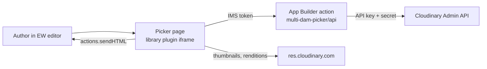

# Multi-DAM Picker (library plugin)

An Experience Workspace (EW) library plugin that lets authors **browse, search, filter and insert assets from a third-party DAM**
while editing a page. The first DAM is **Cloudinary**; the picker shell, provider interface and backend are DAM-agnostic, so later
DAMs (Dropbox, Bynder, Frontify) add one module and one registry line. Spec: [SPEC.md](SPEC.md) (ticket #23).

- **Browse and search** (typing searches after a short pause, Enter searches at once), filter by type (images, videos, documents,
  audio), sort by newest, oldest, name or relevance, "Load more".
- **Insert** an image with a chosen rendition (default `web`: at most 1200 px wide, automatic format and quality, never upscaled) and
  alt text prefilled from the asset's metadata (editable, or mark the image decorative). Videos, audio, PDFs and other files are
  inserted as a link with the asset name.
- **No sign-in for authors.** The Cloudinary API key and secret live only in the extension's Adobe App Builder backend (`worker/`).
  The browser calls only that backend, with the author's Adobe IMS token from EW.



| Item | Value |
| --- | --- |
| DA test site | `https://da.live/#/jazhou-adobe/ew-extensions-demo` |
| App Builder | org `adobe-demo-apac-195`, project `ew extensions` |
| Stage backend | `https://281295-ewextensions-stage.adobeioruntime.net/api/v1/web/multi-dam-picker/api` |
| Production backend | `https://281295-ewextensions.adobeioruntime.net/api/v1/web/multi-dam-picker/api` (not deployed yet) |
| Cloudinary test environment | cloud name `yifoe45l`, root folder `samples/` |

---

## 1. Installing

### Prerequisites

- Node 22 and `npm ci` in the repo root.
- Adobe `aio` CLI logged in, with org `adobe-demo-apac-195` and project `ew extensions` selected (`env -u CI aio where`).
  Run every `aio` command as `env -u CI aio ...` if your shell sets `CI=true`.
- A Cloudinary account (the Free plan is enough) and config-write access to the DA test site.

### Getting the keys and accounts

You need four things. The Cloudinary key and secret and the `AIO_*` lines are secrets: keep them only in the untracked `.env`.

| What | Used for | Secret? |
| --- | --- | --- |
| Cloudinary cloud name | `CLOUDINARY_CLOUD_NAME` in `worker/.env` | no |
| Cloudinary API key and API secret | `CLOUDINARY_API_KEY`, `CLOUDINARY_API_SECRET` in `worker/.env` | **yes** |
| Adobe App Builder project and `aio` login | deploying the backend; `aio app use` writes the `AIO_*` lines to `.env` | **yes** (`AIO_*` lines) |
| DA site config access | adding the `library` row | n/a |

**1. Cloudinary account, cloud name, API key and secret**

1. Sign up at <https://cloudinary.com/users/register_free> (email, Google or GitHub; no credit card). If asked, choose
   **Programmable Media**.
2. Log in to <https://console.cloudinary.com>, click the **gear icon (Settings)** at the bottom left, then **API Keys**.
   Older consoles show the same values on the Dashboard under "Product Environment Credentials".
3. Copy the **Cloud name** (top of the page) and the **API Key**. Click the eye or copy icon to reveal the **API Secret**.
4. Optional but recommended: click **Generate New API Key** to create a key used only by this picker, so you can revoke it
   without affecting anything else.
5. Put the values **only** in `apps/multi-dam-picker/worker/.env` (gitignored). Never paste the secret into chat, issues, commits or
   screenshots. If it leaks, open the key's row menu, choose **Regenerate secret**, update `.env` and redeploy.

**2. Adobe App Builder project and `aio` login**

1. Open <https://developer.adobe.com/console> and switch to org `adobe-demo-apac-195` (any org with App Builder works).
2. Use the existing project `ew extensions`, or create one with **Create project from template > App Builder**. The template creates
   the **Stage** and **Production** workspaces.
3. Install the CLI and log in from your own terminal. Interactive login does not work in a shell with `CI=true`, hence `env -u CI`:

   ```sh
   npm install -g @adobe/aio-cli
   env -u CI aio login
   env -u CI aio console org select         # adobe-demo-apac-195
   env -u CI aio console project select     # ew extensions
   env -u CI aio console workspace select   # Stage
   env -u CI aio where                      # shows the org, project and workspace
   ```

4. `env -u CI aio app use` (run in `worker/`, see [Deploy the backend](#deploy-the-backend)) writes the workspace credentials into
   `.env` (`AIO_*` lines) and `.aio`. Both are gitignored; never commit them.

**3. DA site config access**

Open `https://da.live/config#/jazhou-adobe/ew-extensions-demo/`. If you can edit the `library` tab, you have access; otherwise ask the
site's admin to grant your Adobe ID config-write permission.

**4. IMS token (only for the optional live tests)**

Open the demo site in the EW editor, open DevTools > Network, open the picker, click a request to the backend and copy the value after
`Bearer ` in its `Authorization` header. It expires after a few hours. Use it only in `IMS_TOKEN=` in your terminal; never commit or
paste it.

### Cloudinary-side setup

1. **Cloud name, key and secret:** see [Getting the keys and accounts](#getting-the-keys-and-accounts). The cloud name is public; the
   key and secret go **only** into `worker/.env`.
2. **Test assets:** upload a few images (and a video and a PDF if you like) into the root folder, e.g. `samples/`.
3. **Alt text:** add it in each asset's contextual metadata field `alt` (or the field you configure). Without it the picker falls back
   to the caption, then the file name, and tells the author which one it used.
4. **Folder mode:** accounts created after 2024-06-04 use `dynamic`. To check, call
   `GET https://api.cloudinary.com/v1_1/<cloud>/config?settings=true` with Basic auth.
5. **Strict transformations** (Console > Settings > Security): if on, unsigned transformed URLs are rejected and you must set
   `CLOUDINARY_SIGN_URLS=true`. Signing is proven by known-answer tests but **not yet against a strict-enabled environment**, so keep
   it `false` until that check (SPEC M6) passes. Assets whose public ID needs percent-encoding (spaces, non-ASCII) cannot be inserted
   while signing is on.
6. **Private CDN or CNAME:** list the host in `CLOUDINARY_DELIVERY_HOSTS`. **EU or AP data centre:** set `CLOUDINARY_API_HOST`.

### Deploy the backend

Run from `apps/multi-dam-picker/worker/`. Deploys are manual: Stage first, Production later.

```sh
cd apps/multi-dam-picker/worker
cp .env.example .env                      # cloud name and folder are prefilled
# edit .env: CLOUDINARY_API_KEY=...  CLOUDINARY_API_SECRET=...
env -u CI aio app use                     # pick Stage; appends AIO_* credentials to .env and writes .aio
git status --short                        # must list neither .env nor .aio
env -u CI aio app deploy                  # the pre-deploy guard runs first
env -u CI aio app get-url                 # expect the Stage backend URL above
```

The pre-deploy guard refuses a deploy when a `$NAME` input is missing from `.env`, a secret is empty, or `ALLOWED_LOCAL_ORIGINS` is
set on a non-Stage namespace.

**Redeploy after any change** to `worker/`, `providers/*/worker/`, `worker/app.config.yaml`, `.env` or `shared/worker-template/`.
The picker page alone does not need a redeploy.

**Production:** run `env -u CI aio app use` and pick Production, set `ALLOWED_LOCAL_ORIGINS=` (empty) in `.env`, then deploy. Pages on
`main--ew-extensions--jazhou-adobe.*` call Production; every other page calls Stage (see `config.js`).

**Rotating the secret:** create the new secret in the Cloudinary Console, update `CLOUDINARY_API_SECRET` in `.env`, then
`env -u CI aio app deploy --action api`. With signing on, every signature changes; URLs already inserted into published pages keep the
old signature (whether Cloudinary still accepts it is checked in SPEC M7).

### Install the picker page

Choose **one** way to serve the page. Option A is the one in use for the DA test site.

#### Option A (recommended): install into the DA test site repo

Copy the browser files into `ew-extensions-demo` (checked out next to this repo), then commit and push there:

```sh
npm run package:extension -- multi-dam-picker ../ew-extensions-demo
cd ../ew-extensions-demo
git add apps/multi-dam-picker && git commit -m "chore: update Multi-DAM Picker" && git push
```

The command replaces `ew-extensions-demo/apps/multi-dam-picker/` with the browser files only (no `worker/`, tests or docs) and records
the source commit in `.vendored.json`. It fails if a page module imports a file outside the extension folder. **Re-run it after every
picker change.** Pages served from `*--ew-extensions-demo--jazhou-adobe.*` always call the **Stage** backend, and the backend allows
those origins through its comma-list `SITE` input.

Then add this row to the `library` tab of `https://da.live/config#/jazhou-adobe/ew-extensions-demo/`. The path is relative, so it
resolves against the demo site itself:

| title | path | format | ref | icon | experience |
| --- | --- | --- | --- | --- | --- |
| Multi-DAM Picker | /apps/multi-dam-picker/multi-dam-picker.html | | | | fullsize-dialog |

#### Option B: serve from this repo

Requires the AEM Code Sync GitHub app on `jazhou-adobe/ew-extensions`; until it is installed,
`https://main--ew-extensions--jazhou-adobe.aem.live/...` returns 404.

##### `library` sheet row

In `https://da.live/config#/jazhou-adobe/ew-extensions-demo/`, `library` tab. Add these rows **in this order**: the editor shows the
first allowed row for a title, so the `local` and branch rows win over `main` only when the editor URL has the matching `?ref=`. The
code lives in this repo, not the demo site's repo, so the paths are absolute.

| title | path | format | ref | icon | experience |
| --- | --- | --- | --- | --- | --- |
| Multi-DAM Picker | http://localhost:3000/apps/multi-dam-picker/multi-dam-picker.html | | local | | fullsize-dialog |
| Multi-DAM Picker | https://BRANCH--ew-extensions--jazhou-adobe.aem.live/apps/multi-dam-picker/multi-dam-picker.html | | BRANCH | | fullsize-dialog |
| Multi-DAM Picker | https://main--ew-extensions--jazhou-adobe.aem.live/apps/multi-dam-picker/multi-dam-picker.html | | | | fullsize-dialog |

Replace `BRANCH` (twice) with a simple branch name (no `/`), and keep that row only while you test the branch. The `local` row
works without Code Sync: run `npm start` and open the editor with `?ref=local`. `experience` may also be blank (inline); the page
works in both. `fullsize-dialog` is known from the da-live source, not from the public docs.

### Site config read

None beyond the library row: the page reads no other site config.

---

## 2. Configuration

Every input of `worker/app.config.yaml`. `$NAME` values are read from `worker/.env` at deploy time; the others are literals in the app
config (edit them, then redeploy).

| Input | Kind | Meaning |
| --- | --- | --- |
| `CLOUDINARY_API_KEY` | **secret** (`.env`) | Cloudinary API key (Basic user). Required. |
| `CLOUDINARY_API_SECRET` | **secret** (`.env`) | Cloudinary API secret (Basic password and URL-signing secret). Required. |
| `CLOUDINARY_CLOUD_NAME` | `.env`, required | Product environment, e.g. `yifoe45l`. Public in every delivery URL. |
| `CLOUDINARY_ROOT_FOLDER` | `.env` | Folder the picker is confined to, with its subfolders (`samples/`). Empty = the whole environment. |
| `CLOUDINARY_FOLDER_MODE` | `.env` | `dynamic` (accounts created after 2024-06-04) or `fixed` (legacy). |
| `CLOUDINARY_SIGN_URLS` | `.env` | `true` signs every rendition and thumbnail URL on the server (needed with Strict transformations). |
| `ALLOWED_LOCAL_ORIGINS` | `.env` | Exact extra origins, comma list. Stage: `http://localhost:3000` for `ref=local`. Production: empty. |
| `ORG`, `SITE` | literal | Code-site owner and code sites whose pages may call the backend. `SITE` is a comma list: `ew-extensions,ew-extensions-demo`. |
| `CLOUDINARY_API_HOST` | literal | One of `api.cloudinary.com` (default), `api-eu.cloudinary.com`, `api-ap.cloudinary.com`. |
| `CLOUDINARY_SIGNATURE_ALGORITHM` | literal | `sha1` (default) or `sha256`, matching the account's signature algorithm. |
| `CLOUDINARY_ALT_CONTEXT_FIELD` | literal | Contextual-metadata field holding alt text (default `alt`). |
| `CLOUDINARY_CAPTION_CONTEXT_FIELD` | literal | Contextual-metadata field used as the alt fallback (default `caption`). |
| `CLOUDINARY_ALT_METADATA_FIELD` | literal | Optional structured-metadata field for alt text (detail only; empty = unused). |
| `CLOUDINARY_RENDITIONS` | literal | Optional JSON list `[{ "id", "label", "transformation", "width" }]` replacing the default renditions (at most 8; `original` is reserved). |
| `CLOUDINARY_DELIVERY_HOSTS` | literal | Extra delivery hosts (private CDN or CNAME), comma list of bare host names. `res.cloudinary.com` is always allowed. |
| `CLOUDINARY_CACHE_SECONDS` | literal | Result-cache lifetime in seconds (default `30`; `0` disables). |

The other template inputs (`IMS_ORIGIN`, `ALLOWED_IMS_CLIENT_IDS`, `STATE_REGION`) are described in the
[backend template README](../../shared/worker-template/README.md).

**Default renditions:** `web` (1200 px), `large` (2000), `medium` (800), `small` (400). Each uses `c_limit` (scale down only) with
`f_auto` and `q_auto`, plus `original` for browser-displayable formats (jpg, jpeg, png, gif, webp, avif, svg).

**Adding a site that may call the backend:** add it to `SITE` in `worker/app.config.yaml`, redeploy, and (if that site should use a
specific backend) extend `workerFor` in `config.js`.

---

## 3. Testing

### Local development and automated tests

No login, no network, no credentials. CI runs the same checks.

```sh
npm run lint && npm run check   # ESLint/Stylelint and repo conventions
npm test                        # browser unit tests (picker UI, worker URL by hostname) and script tests
npm run test:worker             # backend: shell, conformance, Cloudinary provider, emulator tier
npm run test:e2e                # Playwright: page -> real action behind the emulator -> fake IMS and fake Cloudinary
npm start                       # page on http://localhost:3000 (the fixed ref=local origin)
```

The page on `localhost` calls the **Stage** backend, which allows `http://localhost:3000` through `ALLOWED_LOCAL_ORIGINS`.
The Cloudinary fixtures under `providers/cloudinary/worker/fixtures/` are hand-written from the docs. To replace them with sanitised
real responses (about 3 Admin API calls), run `node apps/multi-dam-picker/providers/cloudinary/worker/record-fixtures.mjs` with the
key and secret in your environment, then review the diff.

### Deployed backend smoke checks

```sh
U=https://281295-ewextensions-stage.adobeioruntime.net/api/v1/web/multi-dam-picker/api
curl -s -o /dev/null -w "%{http_code}\n" "$U/dam/providers"                                     # 401: no token
curl -s -o /dev/null -w "%{http_code}\n" -H "Origin: https://evil.example" "$U/dam/providers"   # 403: foreign origin
curl -s -o /dev/null -w "%{http_code}\n" -X OPTIONS \
  -H "Origin: https://main--ew-extensions-demo--jazhou-adobe.preview.da.live" \
  -H "Access-Control-Request-Method: GET" -H "Access-Control-Request-Headers: authorization" \
  "$U/dam/providers"                                                                           # 204: demo site allowed
```

### Live tests against the deployed backend

Opt-in, never in CI, skipped when the variables are unset. Copy a real token from DevTools on da.live (an `Authorization` request
header); never commit or paste it.

```sh
export WORKER_BASE_URL=$U WORKER_ENV=stage IMS_TOKEN=<token>
npm run test:picker:live   # LV1-LV6 (deployed backend) and LC1-LC3 (real Cloudinary; at most 4 Admin API calls)
```

### Manual test in EW

1. Open any page of `ew-extensions-demo` in the EW editor. Add `?ref=local` only when testing the `local` row with `npm start`.
2. Open the library and choose **Multi-DAM Picker**. Expected: a grid of assets from `samples/` with thumbnails.
3. Type a keyword and check the results narrow. Change the type filter and the sort order.
4. Open an image, choose a rendition, check the alt text, and click **Insert**. Expected: the image appears in the document, and the
   library closes.
5. Insert a PDF or video. Expected: a link with the asset name.
6. Preview the page and check the image loads from `res.cloudinary.com`.
7. DevTools > Network: backend calls go to the Stage URL, and no request or response carries the Cloudinary key or secret.

### Troubleshooting

| Symptom | Cause and fix |
| --- | --- |
| CORS error: preflight has no `Access-Control-Allow-Origin` | The page's origin is not allowed by the **deployed** backend. Check that it is in `SITE`, then redeploy. Confirm with the `204` curl above. |
| "Not available here" in the picker | The page hostname is not mapped in `config.js` `workerFor` (e.g. a fork or another site). |
| `401` from the backend in EW | Missing or expired IMS token. Reload the editor. If `ALLOWED_IMS_CLIENT_IDS` is set, check it matches the token's `client_id`. |
| `502 upstream_unavailable` | Cloudinary rejected the credentials (wrong key/secret, or a rotated secret not redeployed) or is down. |
| `429` with `Retry-After` | Admin API quota nearly spent (500/hour on Free). Wait for the hour to reset. |
| Picker not in the library | The `library` row is missing, the title is duplicated, or (Option B) Code Sync is not serving the code (404). |

---

## 4. Reference

### Shared-credential model

Every EW author who can reach the backend sees **the same Cloudinary assets**: the backend acts with one Cloudinary credential, so
Cloudinary's per-user permissions do not apply. The controls are:

- the root folder `CLOUDINARY_ROOT_FOLDER`, applied to search and detail;
- only the public `upload` delivery type (`private` and `authenticated` assets are never listed);
- the backend's IMS-token check, with an optional `ALLOWED_IMS_CLIENT_IDS` allow-list;
- an optional `authorize` hook for a per-user allow-list.

Assets with access control or rejected by moderation are listed but cannot be inserted. Use a dedicated Cloudinary environment or a
folder that is safe for every author.

### Limits

- **Admin API quota:** 500 requests per hour on the Free plan (paid plans from 2,000), shared by every author. The page debounces
  search (350 ms) and cancels superseded requests. Pages are 24 results (hard cap 50). Results are cached for
  `CLOUDINARY_CACHE_SECONDS` (30 s) in App Builder State. When fewer than 20 requests remain, the backend answers `429` until the
  window resets. Thumbnails and renditions come from the CDN and do not count.
- **Free plan credits:** 25 per month (about 25,000 new transformed URLs; each previewed thumbnail and inserted rendition is one on
  first view), which is why the picker keeps one thumbnail size and a short rendition list.
- **Result window:** a query shows its first **500** matches; narrow it with a keyword, type or folder.
- **Consistency:** search is eventually consistent (seconds); asset detail is immediate.
- **Inserted URLs are references, not copies:** deleting an asset breaks the page; renaming or moving does not (dynamic folder mode).
- **App Builder:** 1 MB response and 25 s per action, shared with every action in the workspace. A cold start adds latency to the
  first call; the page shows a working state and gives up after 20 s with a retry.

### Privacy

The page sends the author's IMS token only to the backend whose origin is fixed by the page's hostname (a `?worker=` parameter is
ignored). The backend keeps no per-user data: State holds only cached results and the rate-limit record. Logs carry request ids, the
route, status and the verified user id; never tokens, secrets, search text or asset data. Thumbnails and renditions load from
`res.cloudinary.com` (or your delivery hosts) in the author's browser.

### Cloudinary provider

Module: `providers/cloudinary/worker/` (config validators, search expression, mapping, renditions, server-side signing, alt-text chain,
error and quota handling, fixtures and tests). Credential kind `service`: one shared key and secret, no per-user sign-in.

### Add a provider

A DAM is one module plus one registry line; the shell (auth, routing, validation, cache, error mapping, output URL policy, UI) is not
touched. Checklist:

1. Create `providers/<vendor>/worker/index.js` exporting the declaration below, with its own config validators, fixtures
   (`fixtures/README.md` says how they were recorded) and tests. No browser code, `package.json` or app config under `providers/`.
2. Add one line to `worker/providers.js`.
3. Add the provider's `$NAME` inputs to `worker/app.config.yaml` and `worker/.env.example`, and document them here.
4. Add a section for it to this README and a conformance test that registers it. `npm run check` enforces all of this, and that the
   vendor name appears nowhere outside `providers/<vendor>/`, tests, fixtures, docs, the registry line and the app config.

| Member | Meaning |
| --- | --- |
| `id`, `label`, `credentialKind` | lower-case slug (namespaces routes, config and cache), shown name, `service` or `user-oauth` |
| `assetTypes`, `sorts`, `defaultSort`, `window`, `assetIdPattern` | capabilities that drive the UI; the shell never asks beyond `window` and validates ids against the anchored pattern |
| `outboundHosts(config)`, `deliveryHosts(config)` | hosts the provider may call (the `proxy` it gets is pinned to them) and hosts allowed in every URL it returns |
| `cacheSeconds(config)`, `fingerprint(config)` | result-cache lifetime (0 disables) and the config that scopes cache keys |
| `config { required, secrets, resolve(raw) }` | inputs; a provider with an empty required input is omitted, an invalid present value throws `ConfigError(setting)` |
| `search(ctx, query)`, `getAsset(ctx, id)` | normalised summaries (`{ items, total?, hasMore }`) and detail (renditions, alt, `insertable`, `linkUrl`) |
| failures | throw `ProviderError(kind)`: `bad_request`, `not_found`, `forbidden`, `rate_limited`, `misconfigured`, `upstream_unavailable` |
| `user-oauth` only | `scopes`, `buildAuthorizeUrl`, `exchangeCode`, `refresh`, `accountName`, optional `revoke`/`maxStateLength` |

`user-oauth` is **defined and validated but not hosted yet**: registering such a provider fails the registry build ("credential kind
not hosted by this build") until ticket #25 adds the OAuth routes, token store and browser connect panel. The provider list already
carries `credentialKind` and `connection.state`; the browser shows any provider that is not `connected` as unavailable (the single
extension point #25 replaces). The routes `/dam/{provider}/connect|session|disconnect` and `/oauth/{provider}/begin|callback` are
reserved and not routed. A provider's `ctx` holds only `config`, `secret(name)` (its own secrets), a pinned `proxy`, a namespaced
best-effort `store`, `now`, `log` and `requestId`: never the IMS token, headers or cookies.

### Files

| Path | Contents |
| --- | --- |
| `multi-dam-picker.html` | entry page |
| `multi-dam-picker.js`, `multi-dam-picker-render.js` | bootstrap; render and logic entry |
| `config.js` | backend URL by page hostname |
| `picker/` | API client, browse view, detail view, insertion |
| `multi-dam-picker.css` | styles |
| `test/unit`, `test/e2e` | browser unit tests, Playwright tests |
| [`worker/`](worker/README.md) | backend shell, routes, app config, `.env.example` |
| `providers/cloudinary/worker/` | Cloudinary module, fixtures, tests, live checks |
